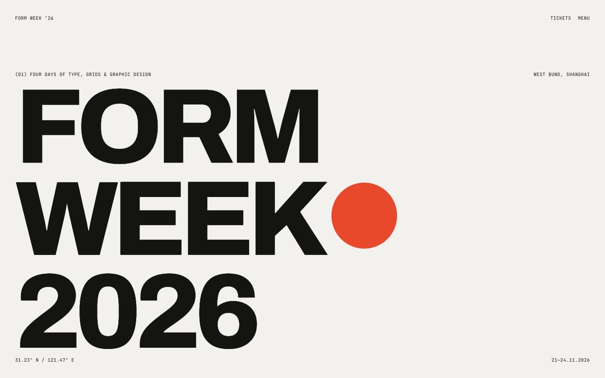
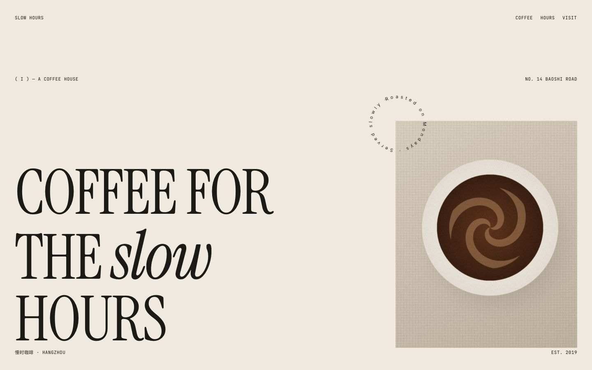
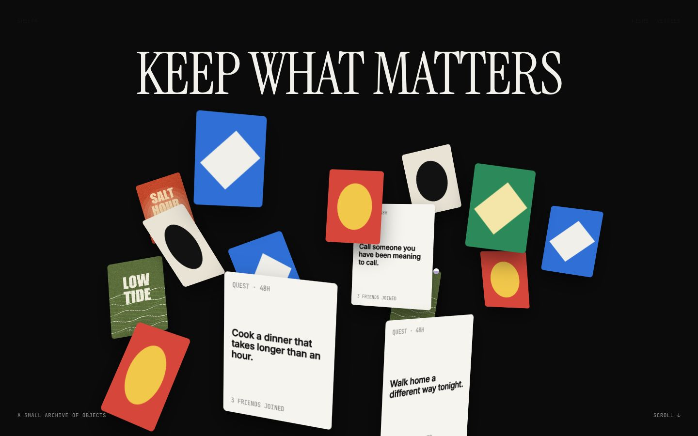

# awwwards-web-design

Typography-first, restrained, expressive websites — no code required.

awwwards-web-design 是一个给 Claude Code 使用的 skill，帮助不会写代码的人用自然语言做出简约、高级、有动效的静态网页。它以大字排版、克制配色和滚动叙事为核心，可以做出接近 Awwwards 获奖站气质的品牌官网、作品集、活动页和产品页。

  

## 安装

```bash
git clone https://github.com/B1itE2/awwwards-web-design.git
cp -r awwwards-web-design/awwwards-web-design ~/.claude/skills/
```

然后重启 Claude Code。也可以放到项目里的 `.claude/skills/` 下，只对该项目生效。

## 怎么用

1. 打开[中英双语使用手册](docs/manual.md)，看图挑一种风格和你喜欢的效果。
2. 在 Claude Code 里说明网页用途、主要内容、风格和想要的效果，不用写代码或记模块名。
3. 生成后双击 `index.html` 预览，再直接用自然语言提出修改。

动效可以根据内容组合：一页先选一种整体风格，再挑 2–4 种重点效果，并说明各自放在哪个区块。不同的整体风格不建议在同一页混用。

一句话示例：

> 「用海报排版型做一个独立设计展活动页，黑白为主、标题特别大，首屏标题逐词升起，底部加活动日期跑马灯；我暂时没有图片，可以先用几何图形占位。」

## 包含什么

- 3 种风格：海报排版型、编辑叙事型、商品展示型。
- 27 个效果模块：文字、进场、叙事、图片、展示、布局、交互、数字、实物、装饰和导航。
- 4 个完整示例页：`assets/examples/` 下的 poster、editorial、showcase、pets（白底宠物商品页），双击 `index.html` 即可打开。
- 离线可用：字体、样式、脚本和动画库均在本地，不依赖 CDN。

## 使用手册

完整的效果参考图、自然语言说法和常见问题见[使用手册](docs/manual.md)。

## 目录结构

```text
awwwards-web-design/
├── README.md
├── LICENSE
├── docs/
│   ├── manual.md
│   └── images/
└── awwwards-web-design/
    ├── SKILL.md
    ├── references/
    ├── scripts/
    └── assets/
```

## 致谢与授权

- 作者：morebelessed（[@B1itE2](https://github.com/B1itE2)）
- 授权：免费使用；用它做出来的网页可以商用，不需要署名。分享本 skill 请注明作者 morebelessed 和本仓库链接；未经许可不得出售或放进收费产品。详见 [LICENSE](LICENSE)。
- 字体：Archivo、Inter、JetBrains Mono、Instrument Serif、Caveat，均为 SIL Open Font License 1.1
- 动画库：GSAP（GSAP Standard License，免费可商用）、Lenis（MIT）
- 设计规律提炼自 Awwwards 获奖站的公开观察。仓库中的图片为本项目示例页截图、代码生成的占位图，以及 pets 示例使用的 AI 生成宠物图（由作者提供，可随本仓库公开使用），不包含任何第三方网站的素材。
