# awwwards-web 使用手册

**中文** · [English](#english-version)

## 怎么开始

1. 先看下面的风格和效果参考图，挑一种喜欢的整体风格，再挑几个想用在页面里的效果。
2. 在 Claude Code 里用自然语言说明网页用途、主要内容、喜欢的风格和效果。不用写代码，也不用记模块名，直接描述你看到的变化即可。
3. 生成后打开网页检查内容和动效。不满意时，直接指出哪一屏、哪个部分要怎么改。

## 一句话模板

> 「用编辑叙事型做一个精品咖啡馆官网，首屏标题逐词升起，中间用一张大图带轻微视差，营业时间旁边加一个随滚动转动的表盘；整体用米白、深棕和少量砖红，文字简短安静。我暂时没有图片，先用几何图形占位。」

把其中的网站类型、内容、颜色、效果和素材情况换成自己的即可。

## 怎么组合风格和动效

**动效可以自己组合，整体风格一页选一种。** 海报排版型和编辑叙事型决定字体、配色和排版气质；文字进场、滚动叙事、悬停交互等动效，可以根据内容放进同一个页面。多页面网站可以让不同页面使用不同风格。

按这个顺序组合：

1. **先选一种风格**：大字、黑白、展览感选海报排版型；杂志感、衬线、品牌故事选编辑叙事型。
2. **再安排内容**：列出首屏、介绍、作品或产品、详情、联系方式等区块。
3. **给重点内容配效果**：通常选 2–4 种就够了，例如「首屏逐词进场＋作品横滚＋数字计数＋全屏菜单」。
4. **用一句完整的话告诉 Claude**：说清楚风格、页面内容、每个效果的位置、颜色和图片情况。

可以直接照抄这个组合示例：

> 「用海报排版型做一个设计节官网。首屏标题逐词升起，活动日期放在底部循环滚动；嘉宾卡片随页面滚动横向移动，四个活动数据进入画面时计数；右上角加全屏菜单。黑白配橙色，不要加其他颜色。」

组合时记住四条规则：

- 一页一种整体风格，不要把海报排版型和编辑叙事型硬放在同一页。
- 一屏只安排一个主要进场效果，不要给每段文字都加不同动画。
- 表盘、里程表、旋转物件属于「实物」效果，一页最多选一个。
- 跑马灯每页最多 1–2 条；鼠标类效果在手机上会自动关闭，横滚和固定章节会简化。

## 风格

### 海报排版型 poster

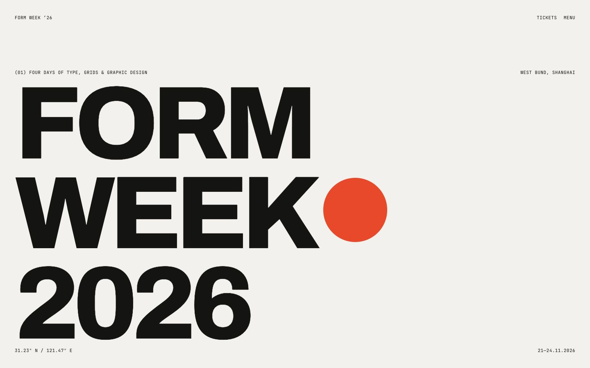

**像什么**：像一张被放大的设计展海报，字很大、留白多、黑白对比鲜明。

**适合**：展览与活动、设计品牌、字体实验、产品发布、创意作品集。

**这样说**：
> 「用海报排版型，做一个独立设计展的活动页。」
> 「黑白为主，字要特别大，像设计展的海报，加一条日期跑马灯。」

**会用到的效果**：
- [文字进场 `reveal`](#文字进场-reveal)
- [句内混排字体 `mixed-type.css`](#句内混排字体-mixed-typecss)
- [撑满宽度的文字 `fit-text`](#撑满宽度的文字-fit-text)
- [圆弧文字 `arc-text`](#圆弧文字-arc-text)
- [横向跑马灯 `marquee`](#横向跑马灯-marquee)

### 编辑叙事型 editorial

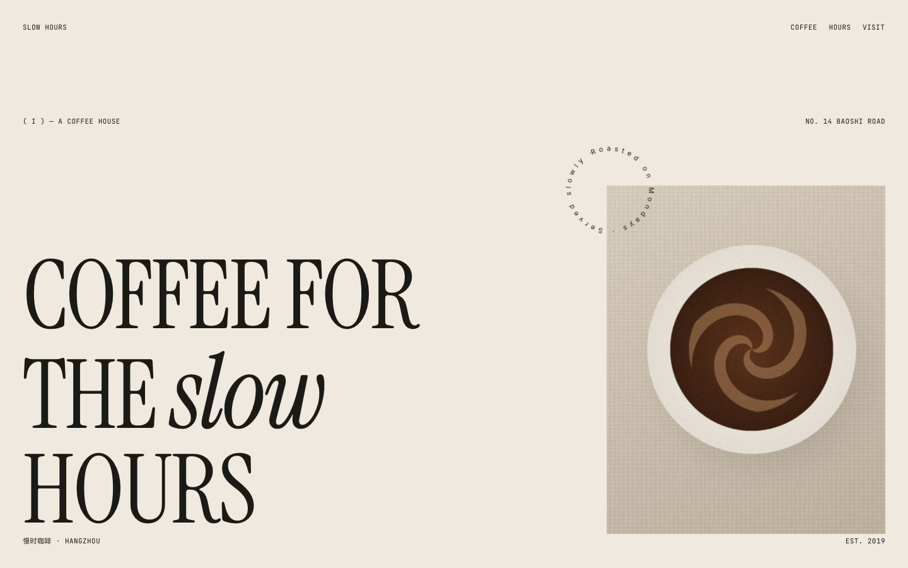

**像什么**：像一本排版克制的生活杂志，衬线标题、细线和图片一起慢慢讲故事。

**适合**：咖啡馆与餐厅、酒店与民宿、生活方式品牌、香氛与护肤、品牌故事页。

**这样说**：
> 「用编辑叙事型，做一个山间民宿官网，像杂志一样安静优雅。」
> 「米白底色，配深色衬线标题，图片进入页面时慢慢展开。」

**会用到的效果**：
- [文字进场 `reveal`](#文字进场-reveal)
- [句内混排字体 `mixed-type.css`](#句内混排字体-mixed-typecss)
- [图片裁切揭示 `img-reveal`](#图片裁切揭示-img-reveal)
- [轻微视差 `parallax`](#轻微视差-parallax)
- [悬停换字 `hover-swap`](#悬停换字-hover-swap)
- [手绘圈选 `scribble`](#手绘圈选-scribble)

## 效果

### 文字

#### 文字进场 `reveal`

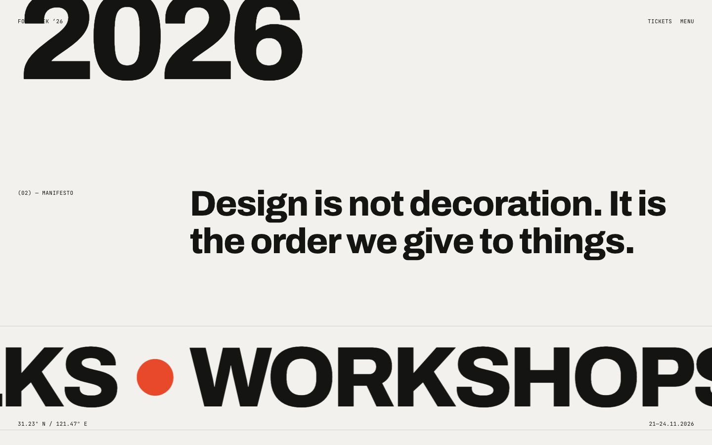

**效果**：标题或段落进入画面时，可以逐行、逐词或逐字从遮罩里升起，也可以整块淡入上移；首屏标题还能在打开页面时直接播放。

**适合**：首屏标题、章节标题、重要宣言和关键段落。

**这样说**：
> 「首屏大标题打开页面时逐词升起，后面的章节标题进入画面时逐行出现。」

**注意**：一屏只安排一组重点进场，不要让所有文字分别乱动。

#### 句内混排字体 `mixed-type.css`

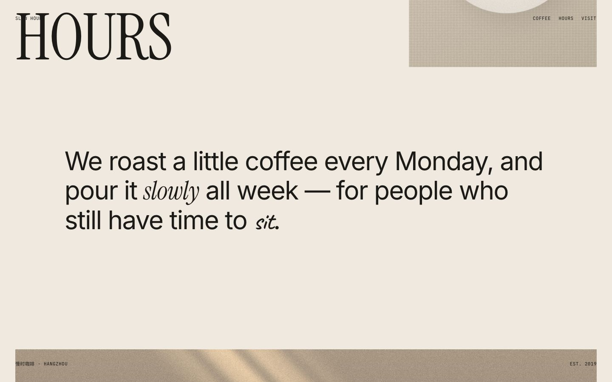

**效果**：同一句话里混用不同字体，例如正文用无衬线体，重点词换成衬线斜体，形成明显的语气变化。

**适合**：品牌宣言、章节引言、关于我们和一句需要被记住的话。

**这样说**：
> 「这段品牌介绍里，把『慢慢生活』换成衬线斜体，其余文字保持简洁。」

#### 圆弧文字 `arc-text`

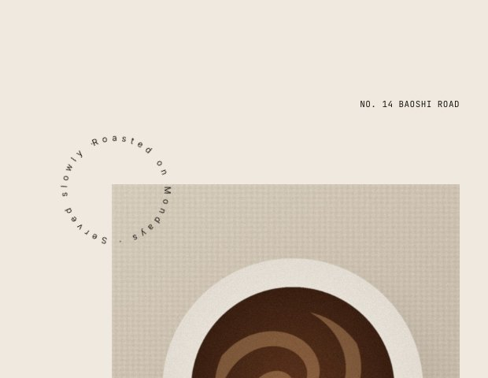

**效果**：一句短文字沿圆弧或整圈排列，滚动页面时整圈缓慢转动，往回滚会反转。

**适合**：图片旁的圆形徽章、标题旁的短标语、活动日期和品牌口号。

**这样说**：
> 「在首屏图片右上角加一圈『OPEN ALL YEAR』，往下滚动时慢慢转。」

**注意**：适合 10–40 个字符的短句，不要放长段文字。

#### 点阵字标 `dot-matrix`

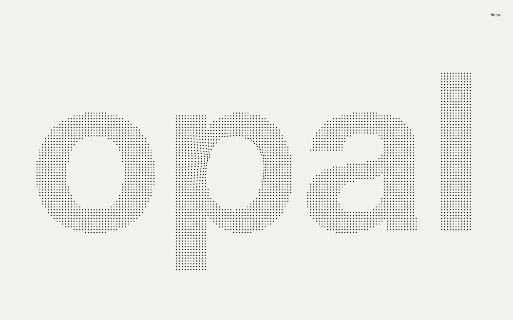

**效果**：一个短单词由许多小点组成，鼠标靠近时，附近的点会被推开，鼠标离开后弹回原位。

**适合**：科技产品页、实验性作品集、数字品牌首屏。

**这样说**：
> 「首屏放一个由小点组成的『OPAL』，鼠标移过去时点子会散开再弹回来。」

**注意**：使用 3–8 个字母的短单词；触摸屏上显示静态点阵，不做鼠标扰动。

#### 撑满宽度的文字 `fit-text`

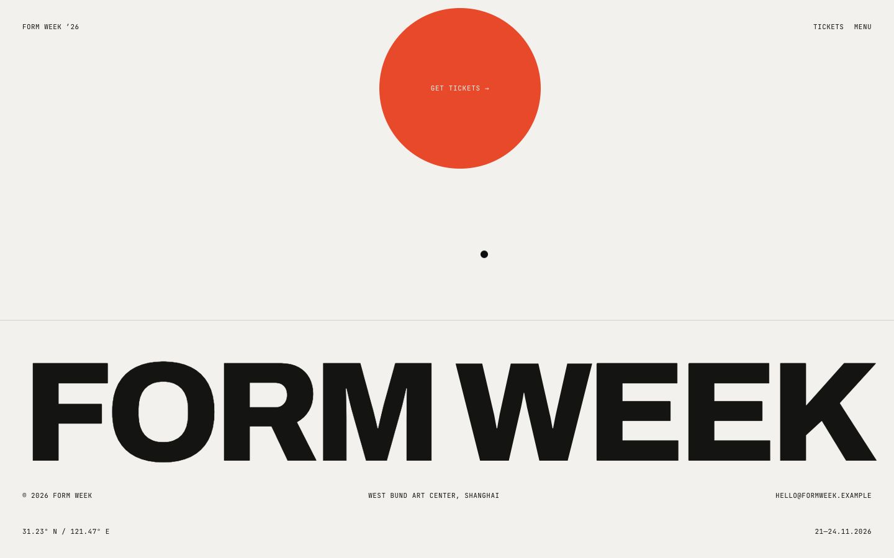

**效果**：一个单词或品牌名自动放大到正好撑满所在区域的宽度，进入画面时还可以逐字升起。

**适合**：首屏单词、页脚巨型品牌名、展览或活动名称。

**这样说**：
> 「页脚把品牌名放到最大，左右都撑满，滚到这里时逐字升起来。」

### 进场

#### 百分比预载 `preloader`

（暂无参考图）

**效果**：网页打开时先显示从 0 到 100 的百分比计数，完成后整块向上收起，再露出首屏内容。

**适合**：品牌官网、作品集、活动页等需要开场仪式感的页面。

**这样说**：
> 「打开网页时先显示百分比计数，到 100 后向上收起，再让首屏标题出现。」

**注意**：整个网站只用一次；工具或文档类页面不建议加。

### 叙事

#### 逐条叙事 `steps`

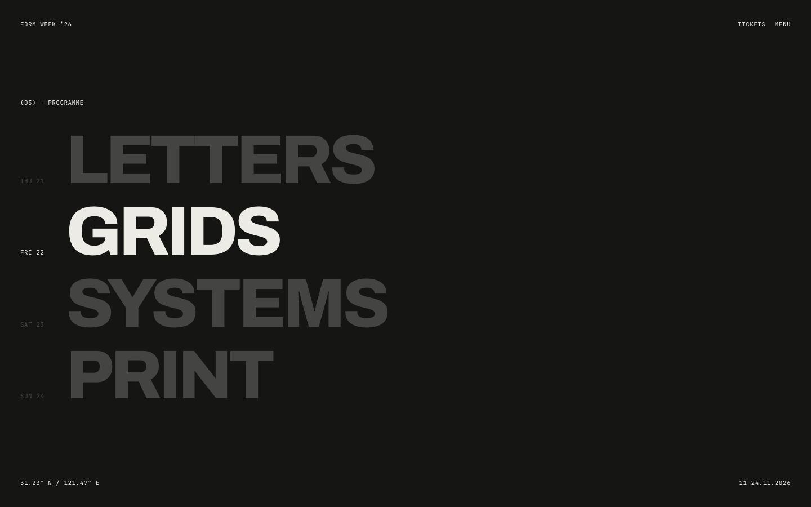

**效果**：一个章节暂时固定在屏幕上，继续滚动时逐条点亮内容，当前项保持清晰，其余条目变暗。

**适合**：活动议程、设计原则、服务流程、品牌理念等 4–6 条并列内容。

**这样说**：
> 「把四个服务步骤做成逐条叙事，滚动到哪一条，哪一条变亮，其他几条压暗。」

**注意**：准备 4–6 条内容，每条尽量短，大字呈现的效果最好。

### 图片

#### 首屏图片轮换 `hero-cycle`

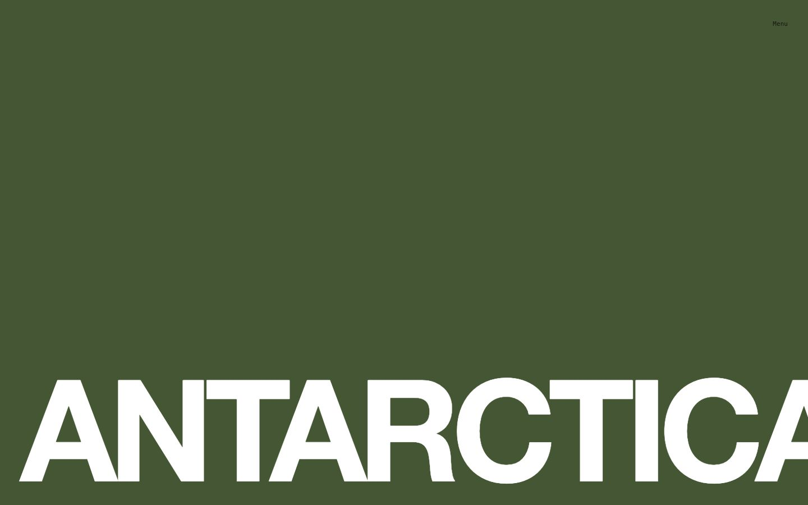

**效果**：首屏的大标题保持不动，背景大图或视频自动交叉淡入淡出，同时缓慢缩放。

**适合**：酒店与民宿、服装与香氛、产品发布、摄影作品集。

**这样说**：
> 「首屏大标题一直固定，后面三张空间照片慢慢轮换，切换时柔和淡入淡出。」

**注意**：准备 3–5 张高质量大图；也可以使用视频。

#### 图片裁切揭示 `img-reveal`

（暂无参考图）

**效果**：图片进入画面时，从某一个方向逐渐裁切展开，同时从略微放大的状态回到正常比例。

**适合**：品牌故事里的主图、产品细节、空间和人物照片。

**这样说**：
> 「这张空间照片滚到画面里时，从下到上慢慢展开，不要突然出现。」

**注意**：一屏最多放一张这样的揭示图片。

#### 轻微视差 `parallax`

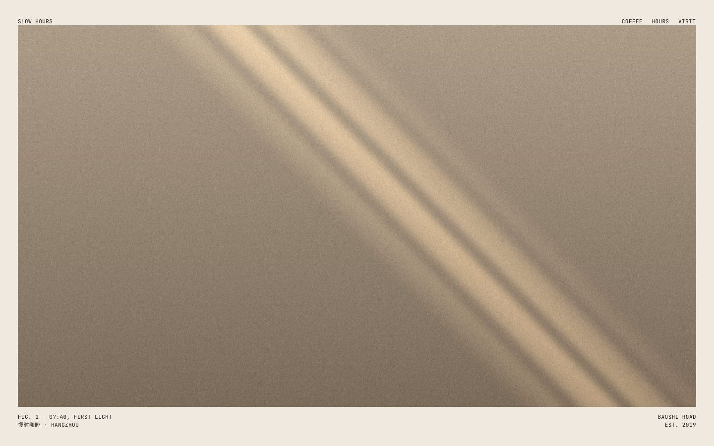

**效果**：滚动页面时，大图与页面以不同速度上下移动，往回滚时也会同步反向移动。

**适合**：全宽摄影图、产品场景图、酒店与建筑图片。

**这样说**：
> 「中间这张大图滚动时有一点上下错速，幅度小一点，不要晃。」

**注意**：只做轻微视差，不要让图片快速、大幅移动。

### 布局

#### 横向拖拽画廊 `drag-gallery`

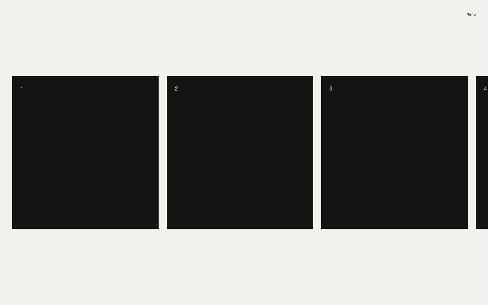

**效果**：一行图片可以左右拖动，松手后带惯性继续滑行，拖过头时会在边缘阻尼回弹。

**适合**：摄影画廊、作品合集、产品系列、空间照片。

**这样说**：
> 「作品做成一排可以自由左右拖动的画廊，松手后有一点惯性。」

#### 滚动变横移 `hscroll`

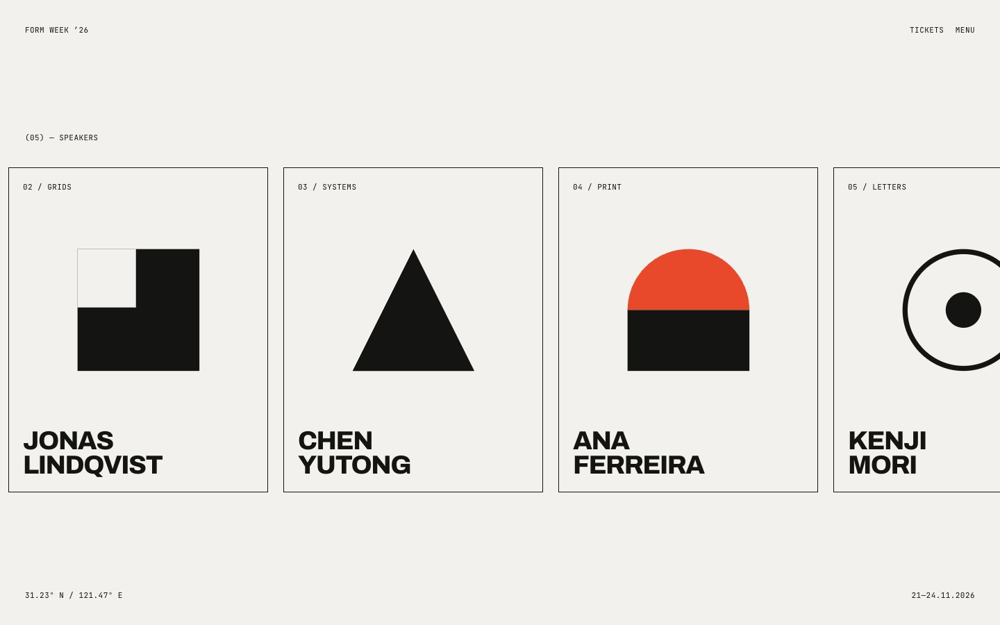

**效果**：桌面端滚到这个区块时，区块暂时固定，继续往下滚会让一排卡片横向移动，往回滚则横向退回。

**适合**：嘉宾介绍、作品列表、产品系列、活动日程。

**这样说**：
> 「六位嘉宾做成一排卡片，桌面端往下滚动时卡片向左横移。」

**注意**：手机端会自动改为原生横向滑动，不再固定区块。

#### 章节换色 `theme`

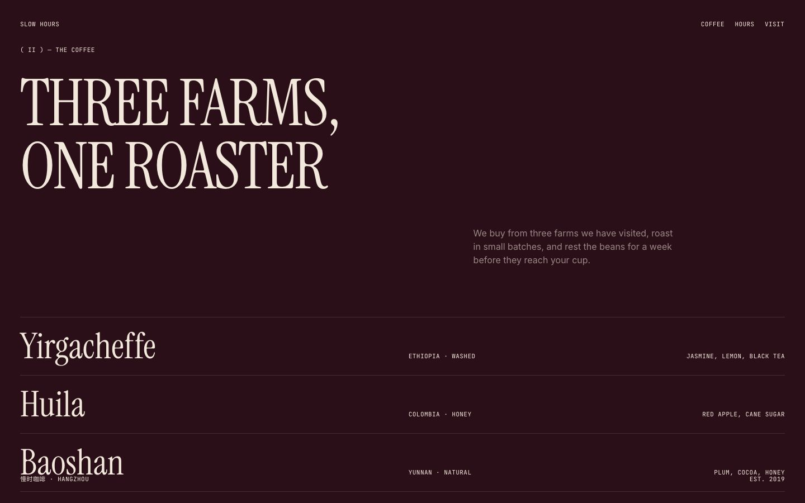

**效果**：章节经过屏幕中线时，整页的背景色和文字色平滑切换；滚回之前的章节，颜色也会跟着回来。

**适合**：品牌故事分章、产品不同卖点、白天与夜晚等情境转换。

**这样说**：
> 「前两个章节用米白底，进入品牌故事时整页慢慢变成深底白字。」

**注意**：整页安排 1–3 个深色章节即可，不要每屏都换色。

### 交互

#### 自定义光标 `cursor`

（暂无参考图）

**效果**：鼠标变成带缓动跟随的小圆点，移到链接或按钮上时会放大，还可以显示「打开」等提示文字。

**适合**：品牌官网、作品集、活动页和需要细节反馈的产品页。

**这样说**：
> 「鼠标换成一个跟随的小圆点，移到作品链接上时放大并显示『查看』。」

**注意**：触摸屏自动关闭；输入框和可编辑区域保留系统光标。

#### 悬停出图 `hover-preview`

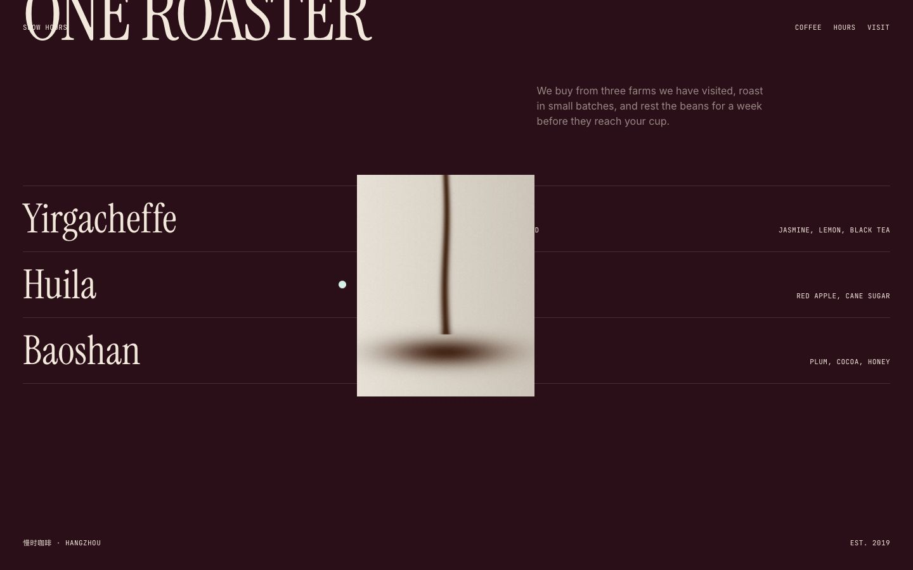

**效果**：鼠标移到列表的某一行，旁边浮出一张对应的图片，跟着鼠标走；换一行就换图。

**适合**：作品列表、菜单、产品产地、团队成员。

**这样说**：
> 「作品做成列表，鼠标放上去显示作品图。」

**注意**：手机上没有鼠标，这个效果会自动关闭，列表照常显示。

#### 悬停换字 `hover-swap`

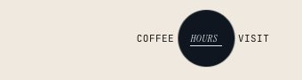

**效果**：鼠标移到导航或文字链接上时，原文字向上滚出，另一层衬线斜体文字从下方滚入。

**适合**：编辑叙事型网站的导航、文章链接、页脚联系链接。

**这样说**：
> 「导航悬停时文字向上翻一下，换成衬线斜体。」

**注意**：触摸屏上自动关闭，文字链接仍可正常使用。

#### 磁吸按钮 `magnetic`

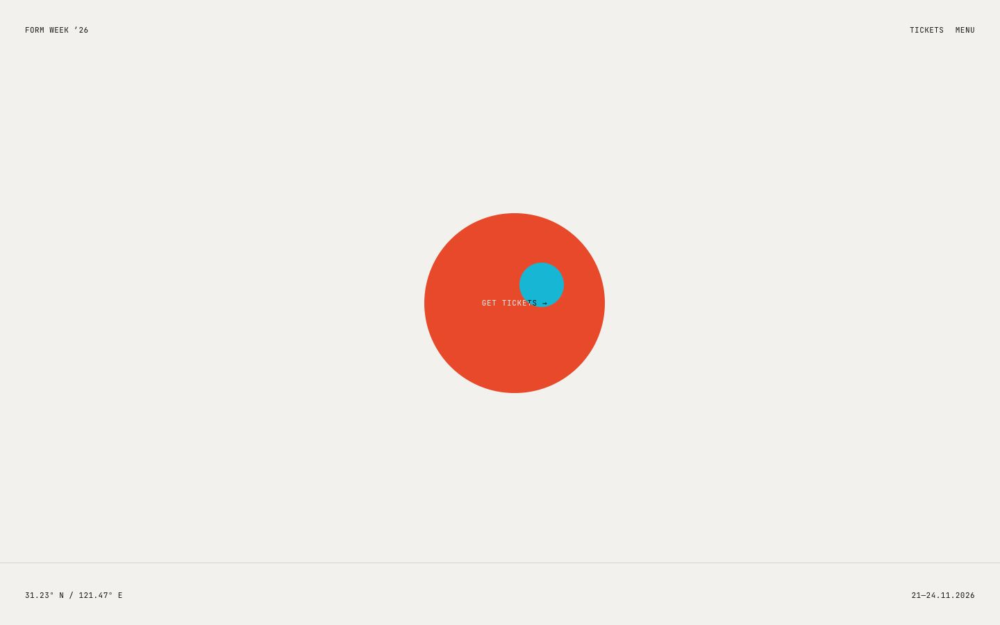

**效果**：鼠标靠近主要按钮时，按钮会轻轻吸向指针；鼠标离开后，按钮弹性回到原位。

**适合**：首屏主要按钮、预约或购买按钮、圆形查看按钮。

**这样说**：
> 「首屏的『预约参观』按钮做一点磁吸，鼠标靠近时轻轻跟过来。」

**注意**：只给主要按钮使用，不要给所有链接都加；触摸屏上自动关闭。

#### 手绘圈选 `scribble`

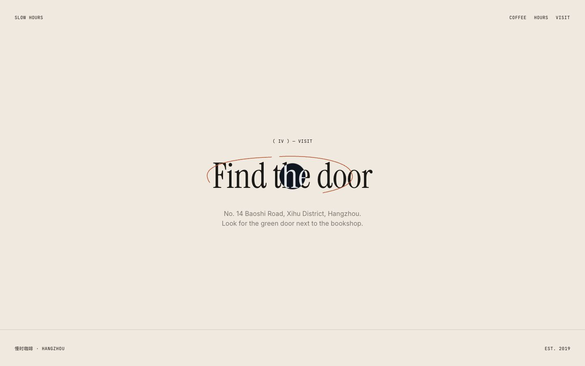

**效果**：鼠标悬停或键盘聚焦到链接时，外围会画出一个不规则的手绘椭圆；移开后，线条反向擦除。

**适合**：需要强调的一个文字链接、当前栏目、编辑叙事型页面的小提示。

**这样说**：
> 「鼠标放到『查看菜单』上时，外面画一个不规则的手绘圆圈。」

### 数字

#### 数字计数 `counter`

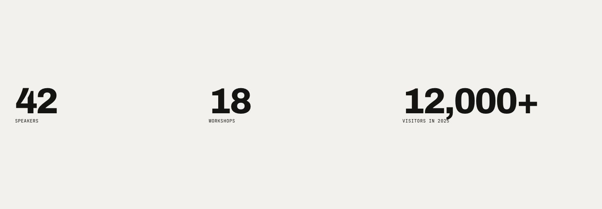

**效果**：数字进入画面后，从起始值逐渐数到目标值，只播放一次，可以带千位分隔、小数或单位后缀。

**适合**：成立年限、服务人数、项目数量、门店规模等成绩数字。

**这样说**：
> 「滚到品牌成绩时，让『128』从零数到 128，下面标注『已完成项目』。」

**注意**：一屏放 2–4 个有意义的数字，并配上简短标签。

### 实物

#### 滚动表盘 `clock`

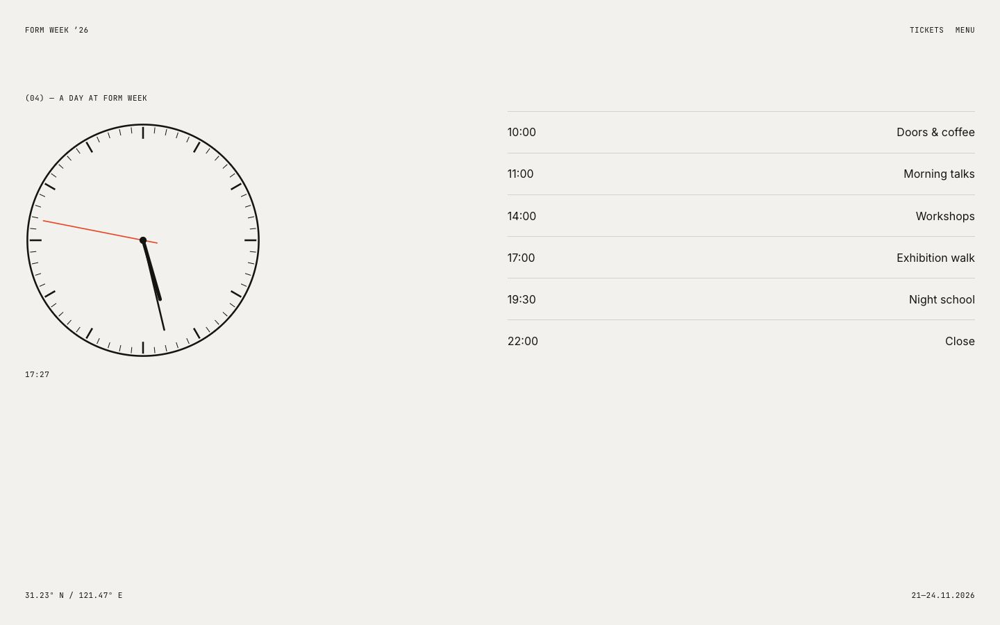

**效果**：页面上有一个表盘，往下滚动时指针跟着转，往回滚指针倒转。

**适合**：主题和时间有关的页面——营业时间、活动日程、「一天的故事」。

**这样说**：
> 「加一个随滚动转动的表盘，从早上 8 点走到晚上 6 点，旁边列营业时间。」

**注意**：一页最多放一个这类「实物」效果（表盘、里程表、旋转物件）。

#### 滚动里程表 `odometer`

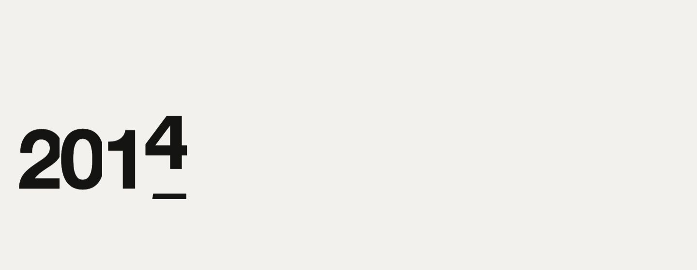

**效果**：每位数字都是竖向滚轮，随页面滚动连续转到目标数字，进位时高位一起转；往回滚会倒转。

**适合**：成立年份、累计里程、参与人数等一个有故事的重点数字。

**这样说**：
> 「让品牌成立年份像机械里程表一样，随着滚动从 0 转到 2018。」

**注意**：一页最多放一个实物效果，并选择真正值得强调的数字。

#### 滚动旋转物件 `rotate`

（暂无参考图）

**效果**：唱片、齿轮、罗盘或徽章等圆形物件随页面滚动旋转，往回滚时同步倒转。

**适合**：音乐主题、机械产品、户外品牌、圆形纪念徽章。

**这样说**：
> 「让这张黑胶唱片随页面滚动转一圈，往回滚时倒着转。」

**注意**：一页最多放一个实物效果，表盘、里程表和旋转物件不要叠加。

### 装饰

#### 横向跑马灯 `marquee`

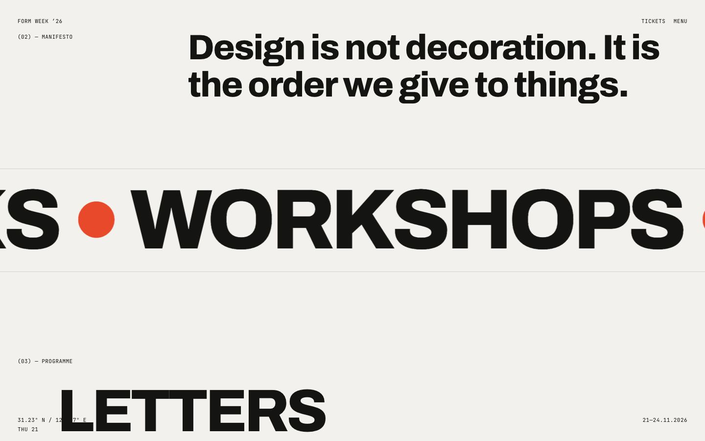

**效果**：日期、口号或客户名无缝横向循环，滚动页面时会加速，并跟随向上或向下的滚动方向改变走势。

**适合**：活动日期、品牌口号、客户名单、展览信息。

**这样说**：
> 「首屏底部加一条活动日期和口号的循环跑马灯，滚动页面时会加速。」

**注意**：每页最多放 1–2 条。

### 导航

#### 全屏菜单 `menu`

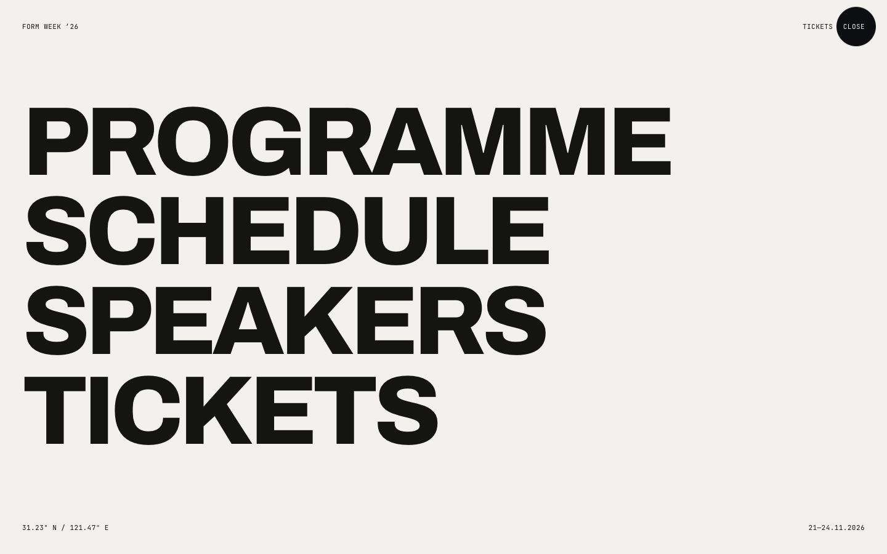

**效果**：点击菜单按钮后，全屏菜单裁切展开，导航链接逐行从遮罩里升起；按 Esc、再次点击或跳转后可以关闭。

**适合**：品牌官网、作品集、活动页和单页网站。

**这样说**：
> 「右上角放一个菜单按钮，点击后展开全屏导航，链接逐行升起。」

**注意**：菜单按钮放在页面右上角。

## 常见问题

### 没有自己的图片怎么办？

可以先用纯色块或简单几何图形占位，不会使用外部图库链接。交付时会列出哪些图片是占位内容，之后替换成自己的素材即可。

### 能做中文网站吗？

能。中文标题会使用系统宋体或黑体，英文使用项目自带字体，中文正文和动效都可以正常呈现。

### 生成的网页怎么打开、怎么上线？

双击项目文件夹里的 `index.html` 就能在浏览器中打开。上线时，把整个文件夹上传到任意静态托管服务即可。

### 手机上效果一样吗？

内容和整体排版会保留，交互方式会适配触摸屏。鼠标类效果会自动关闭，固定章节和滚动横移会简化，内容仍然完整可看。

### 可以混用两种风格吗？

不建议。一页只选海报排版型或编辑叙事型中的一种，再在这个风格里调整颜色、字体和内容，整体会更统一。

### 可以只改某一个效果吗？

可以。直接说哪一屏、哪个元素需要改，例如「首屏标题不要逐字出现，改成整行淡入」，不用重做整页。

### 为什么我的电脑上看不到动效？

如果系统开启了「减少动态效果」，模块会直接显示最终状态，不播放进场和滚动动画。文字、图片和链接仍然完整可用。

---

## English Version

[中文](#awwwards-web-使用手册) · **English**

## Getting started

1. Browse the style and effect screenshots below. Choose one overall style, then pick a few effects for your page.
2. In Claude Code, describe the page's purpose, content, style, and effects in natural language. You do not need to code or memorize module names; describe the visible change you want.
3. Preview the generated page and check its content and motion. To revise it, name the screen or element and describe the change.

## One-sentence template

> “Use the editorial style to create a specialty coffee house website. Reveal the hero title word by word, add subtle parallax to a large image in the middle, and place a scroll-driven clock beside the opening hours. Use warm white, dark brown, and a small amount of brick red, with short, quiet copy. I do not have images yet, so use geometric placeholders.”

Replace the site type, content, colors, effects, and asset notes with your own.

## How to combine styles and effects

**You can combine effects, but choose one overall style per page.** Poster and editorial control typography, color, and layout. Text entrances, scroll stories, hover interactions, and other effects can be combined around your content. In a multi-page site, different pages may use different styles.

Combine them in this order:

1. **Choose one style**: poster for big type, black and white, and an exhibition feel; editorial for a magazine feel, serif type, and brand stories.
2. **Plan the content**: list sections such as the hero, introduction, work or products, details, and contact information.
3. **Assign effects to important content**: two to four effects are usually enough, such as “word-by-word hero reveal + horizontal work gallery + number count-up + full-screen menu.”
4. **Give Claude one complete brief**: include the style, page content, location of each effect, colors, and image availability.

Copy and adapt this combination example:

> “Use the poster style for a design festival website. Reveal the hero title word by word and loop the event dates along the bottom. Move the speaker cards horizontally as I scroll down, count up four event statistics when they enter view, and add a full-screen menu in the top-right corner. Use black, white, and orange only.”

Follow four rules when combining:

- Use one overall style per page instead of forcing poster and editorial into the same page.
- Give each screen one main entrance effect rather than a different animation for every paragraph.
- Clock, odometer, and rotating object are “physical object” effects; choose at most one per page.
- Use no more than one or two marquees per page. Mouse-driven effects turn off on touch devices, while horizontal scrolling and pinned sections are simplified.

## Styles

### Poster style poster

**Feels like**: an enlarged design exhibition poster with oversized type, generous negative space, and strong black-and-white contrast.

**Good for**: exhibitions and events, design brands, typography experiments, product launches, and creative portfolios.

**Say this**:
> “Use the poster style for an independent design exhibition event page.”
> “Keep it mostly black and white, make the type very large, and add an event-date marquee like a design exhibition poster.”

**Effects often used**:
- [Text reveal `reveal`](#text-reveal-reveal)
- [Mixed-type sentence `mixed-type.css`](#mixed-type-sentence-mixed-typecss)
- [Full-width text `fit-text`](#full-width-text-fit-text)
- [Arc text `arc-text`](#arc-text-arc-text)
- [Marquee `marquee`](#marquee-marquee)

### Editorial style editorial

**Feels like**: a restrained lifestyle magazine, with serif headlines, fine rules, and images that unfold as the story progresses.

**Good for**: cafés and restaurants, hotels and guesthouses, lifestyle brands, fragrance and skincare, and brand story pages.

**Say this**:
> “Use the editorial style for a mountain guesthouse website, with the quiet elegance of a magazine.”
> “Use a warm-white background, dark serif headings, and images that gently unfold as they enter the page.”

**Effects often used**:
- [Text reveal `reveal`](#text-reveal-reveal)
- [Mixed-type sentence `mixed-type.css`](#mixed-type-sentence-mixed-typecss)
- [Image reveal `img-reveal`](#image-reveal-img-reveal)
- [Subtle parallax `parallax`](#subtle-parallax-parallax)
- [Hover font swap `hover-swap`](#hover-font-swap-hover-swap)
- [Hand-drawn circle `scribble`](#hand-drawn-circle-scribble)

## Effects

### Typography

#### Text reveal `reveal`

**What you see**: headings or paragraphs rise from masks line by line, word by word, or character by character as they enter view. They can also fade in and move up as a block, and the hero title can play when the page opens.

**Good for**: hero titles, chapter headings, important statements, and key paragraphs.

**Say this**:
> “Reveal the hero title word by word when the page opens, then reveal later chapter headings line by line as they enter view.”

**Note**: use one main reveal group per screen instead of giving every text element its own motion.

#### Mixed-type sentence `mixed-type.css`

**What you see**: different typefaces appear within the same sentence, such as sans-serif body text with a key phrase in italic serif type.

**Good for**: brand statements, chapter introductions, about sections, and one sentence visitors should remember.

**Say this**:
> “In this brand introduction, set the phrase ‘slow living’ in italic serif type and keep the rest clean and simple.”

#### Arc text `arc-text`

**What you see**: a short phrase follows an arc or full circle. The circle rotates slowly as you scroll and reverses when you scroll back.

**Good for**: circular badges beside images, short slogans beside titles, event dates, and brand mottos.

**Say this**:
> “Place ‘OPEN ALL YEAR’ in a circle above the hero image and rotate it slowly as I scroll.”

**Note**: use a short phrase of 10–40 characters, not a long paragraph.

#### Dot-matrix wordmark `dot-matrix`

**What you see**: a short word is made from small dots. Dots near the pointer move away, then spring back when the pointer leaves.

**Good for**: technology product pages, experimental portfolios, and digital brand heroes.

**Say this**:
> “Make the hero word ‘OPAL’ from small dots that scatter near the pointer and spring back.”

**Note**: use one short word of 3–8 letters. Touch devices show a static dot matrix without pointer disturbance.

#### Full-width text `fit-text`

**What you see**: a word or brand name automatically scales to fill the exact width of its container. Its letters can also rise one by one when it enters view.

**Good for**: a hero word, an oversized footer wordmark, and exhibition or event names.

**Say this**:
> “Make the footer brand name as large as possible, filling the full width, and reveal it letter by letter when I scroll to it.”

### Entrance

#### Percentage preloader `preloader`

(No reference image yet)

**What you see**: the page opens with a counter from 0 to 100. The preloader then lifts away to reveal the hero content.

**Good for**: brand sites, portfolios, event pages, and other pages that benefit from an opening ritual.

**Say this**:
> “Show a percentage counter when the page opens. At 100, slide it upward and then reveal the hero title.”

**Note**: use it once per site. It is not recommended for tools or documentation pages.

### Storytelling

#### Step-by-step story `steps`

**What you see**: a section stays temporarily pinned while scrolling highlights one item at a time. The active item stays clear and the others dim.

**Good for**: event agendas, design principles, service processes, and four to six parallel brand ideas.

**Say this**:
> “Present the four service steps one by one. Brighten the current step as I scroll and dim the others.”

**Note**: prepare four to six short items. Large type works best.

### Images

#### Rotating hero media `hero-cycle`

**What you see**: the large hero title stays fixed while background images or videos crossfade automatically and slowly zoom.

**Good for**: hotels and guesthouses, fashion and fragrance, product launches, and photography portfolios.

**Say this**:
> “Keep the hero title fixed while three interior photos rotate slowly behind it with soft crossfades.”

**Note**: prepare three to five high-quality large images. Video can also be used.

#### Image reveal `img-reveal`

(No reference image yet)

**What you see**: as an image enters view, a clip opens from one direction while the image settles from a slightly enlarged state to its normal scale.

**Good for**: key brand-story images, product details, interiors, and portraits.

**Say this**:
> “When this interior photo enters view, reveal it gradually from bottom to top instead of showing it all at once.”

**Note**: use at most one image reveal per screen.

#### Subtle parallax `parallax`

**What you see**: a large image moves vertically at a different speed from the page as you scroll, then moves back in sync when you reverse direction.

**Good for**: full-width photography, product scenes, and hotel or architectural images.

**Say this**:
> “Add a small amount of vertical parallax to the large middle image. Keep the movement subtle, not shaky.”

**Note**: keep parallax subtle rather than moving images quickly or over a large distance.

### Layout

#### Draggable gallery `drag-gallery`

**What you see**: a row of images can be dragged left or right. It glides with inertia after release and springs back with resistance at the edges.

**Good for**: photography galleries, work collections, product ranges, and interior photos.

**Say this**:
> “Make the work a freely draggable horizontal gallery with a little inertia after release.”

#### Scroll-to-horizontal `hscroll`

**What you see**: on desktop, the section stays pinned when you reach it. Further vertical scrolling moves a row of cards horizontally; scrolling back moves them back.

**Good for**: speaker profiles, work lists, product ranges, and event schedules.

**Say this**:
> “Place the six speakers in a row of cards that moves left as I scroll down on desktop.”

**Note**: on mobile, this automatically becomes native horizontal swiping without pinning the section.

#### Section color change `theme`

**What you see**: when a section crosses the middle of the viewport, the page background and text colors transition smoothly. Scrolling back restores the earlier colors.

**Good for**: brand-story chapters, different product benefits, and transitions between settings such as day and night.

**Say this**:
> “Start with two warm-white sections, then slowly transition the whole page to a dark background with light text for the brand story.”

**Note**: use one to three dark sections per page instead of changing colors on every screen.

### Interaction

#### Custom cursor `cursor`

(No reference image yet)

**What you see**: the pointer becomes a small dot that follows with easing. It grows over links or buttons and can display prompt text such as “Open.”

**Good for**: brand sites, portfolios, event pages, and product pages that need detailed feedback.

**Say this**:
> “Replace the pointer with a small trailing dot that grows over project links and displays ‘View’.”

**Note**: it turns off on touch devices. Input fields and editable areas keep the system cursor.

#### Hover image preview `hover-preview`

**What you see**: hovering over a list row reveals its corresponding image beside the list and follows the pointer. Moving to another row swaps the image.

**Good for**: work lists, menus, product origins, and team members.

**Say this**:
> “Present the projects as a list and show the matching project image on hover.”

**Note**: this effect turns off on phones, which have no mouse; the list remains visible.

#### Hover font swap `hover-swap`

**What you see**: on hover, the original navigation or link text rolls upward while an italic serif version rolls in from below.

**Good for**: navigation, article links, and footer contact links on editorial-style sites.

**Say this**:
> “On navigation hover, roll the text upward and swap it to italic serif type.”

**Note**: this effect turns off on touch devices, and the text links continue to work normally.

#### Magnetic button `magnetic`

**What you see**: when the pointer approaches a primary button, the button gently moves toward it. It springs back when the pointer leaves.

**Good for**: primary hero buttons, booking or purchase buttons, and circular view buttons.

**Say this**:
> “Give the hero ‘Book a visit’ button a subtle magnetic pull toward the pointer.”

**Note**: use it only for primary buttons, not every link. It turns off on touch devices.

#### Hand-drawn circle `scribble`

**What you see**: hovering or keyboard-focusing a link draws an irregular hand-drawn ellipse around it. Moving away erases the line in reverse.

**Good for**: one text link that needs emphasis, the current navigation item, and small notes on editorial pages.

**Say this**:
> “Draw an irregular hand-drawn circle around ‘View the menu’ on hover.”

### Numbers

#### Number count-up `counter`

**What you see**: when a number enters view, it counts once from its starting value to its target. It can include thousands separators, decimals, or a suffix.

**Good for**: years in business, people served, project totals, and location counts.

**Say this**:
> “When the brand statistics enter view, count from zero to 128 and label it ‘Completed projects’.”

**Note**: use two to four meaningful numbers per screen, each with a short label.

### Physical objects

#### Scroll-driven clock `clock`

**What you see**: a clock sits on the page. Its hands rotate as you scroll down and reverse when you scroll back.

**Good for**: time-related pages, including opening hours, event schedules, and a “day in the life” story.

**Say this**:
> “Add a scroll-driven clock that moves from 8 AM to 6 PM beside the opening hours.”

**Note**: use at most one physical-object effect per page: clock, odometer, or rotating object.

#### Scroll-driven odometer `odometer`

**What you see**: each digit is a vertical wheel that rolls continuously toward the target number as you scroll. Higher digits advance during carries, and scrolling back reverses the motion.

**Good for**: a meaningful founding year, total distance, or participant count.

**Say this**:
> “Make the founding year behave like a mechanical odometer, rolling from 0 to 2018 as I scroll.”

**Note**: use at most one physical-object effect per page and choose a number worth emphasizing.

#### Scroll-driven object rotation `rotate`

(No reference image yet)

**What you see**: a circular object such as a record, gear, compass, or badge rotates as you scroll and reverses when you scroll back.

**Good for**: music themes, mechanical products, outdoor brands, and circular commemorative badges.

**Say this**:
> “Rotate this vinyl record once as I scroll through the section, then reverse it when I scroll back.”

**Note**: use at most one physical-object effect per page. Do not combine the clock, odometer, and rotating object.

### Decoration

#### Marquee `marquee`

**What you see**: dates, slogans, or client names loop seamlessly across the page. Page scrolling speeds the marquee up and influences its direction.

**Good for**: event dates, brand slogans, client lists, and exhibition information.

**Say this**:
> “Add a looping marquee of event dates and slogans along the bottom of the hero, speeding up as I scroll.”

**Note**: use no more than one or two marquees per page.

### Navigation

#### Full-screen menu `menu`

**What you see**: clicking the menu button clips open a full-screen menu while navigation links rise from masks row by row. Escape, another click, or following an anchor closes it.

**Good for**: brand sites, portfolios, event pages, and single-page sites.

**Say this**:
> “Place a menu button in the top-right corner that opens a full-screen navigation with links rising row by row.”

**Note**: place the menu button in the top-right corner of the page.

## FAQ

### What if I do not have my own images?

Solid colors or simple geometric shapes can be used as placeholders without hotlinking stock photos. The delivery will identify placeholder images so you can replace them with your own assets later.

### Can it build Chinese websites?

Yes. Chinese headings use the system's Song or Hei typefaces, while English uses the bundled fonts. Chinese body copy and motion are fully supported.

### How do I open and publish the generated page?

Double-click `index.html` in the project folder to open it in a browser. To publish it, upload the entire folder to any static hosting service.

### Will it look the same on mobile?

The content and overall layout remain, while interactions adapt to touchscreens. Mouse-driven effects turn off, and pinned sections and scroll-driven horizontal movement are simplified. All content remains available.

### Can I mix both styles?

It is not recommended. Choose either poster or editorial for each page, then adapt its colors, fonts, and content. A multi-page site can use different styles on different pages.

### Can I change just one effect?

Yes. Name the screen and element, then describe the change. For example: “Do not reveal the hero title letter by letter; fade in the whole line instead.” You do not need to rebuild the page.

### Why can I not see the motion on my computer?

If your system has Reduce Motion enabled, modules show their final state without entrance or scroll animation. Text, images, and links remain fully available.
